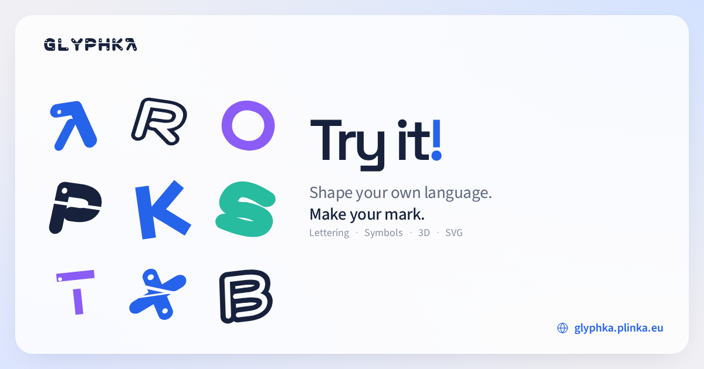

<p align="center">
  <a href="https://glyphka.plinka.eu">
    
  </a>
</p>

<h1 align="center">Glyphka</h1>

<p align="center">Geometric lettering. Expressive symbols. Forms you can make your own.</p>

<p align="center">
  <a href="https://glyphka.plinka.eu">Open Glyphka</a> ·
  <a href="https://plinka.eu">Made by Plinka</a> ·
  <a href="LICENSE.md">MIT license</a>
</p>

Glyphka is a free, open-source studio for generating geometric lettering, building symbols and composing editable vector shapes. Start with a word, explore its visual language and take it from flat paths to an extruded 3D form.

Its alphabet is constructed in code from lines, capsules, circles, arcs and cutouts. There is no font to install or embed in your exported artwork.

## A word. Many directions.

- **24 visual languages.** Explore bold, orbital, modular, woven, fractured and other constructions. Adjust weight, rounding, width, slant, spacing, mutation and cutouts.
- **Individual glyphs.** Click a letter to work on its symbol and explore alternate drawings, then return to the full word.
- **Procedural shapes.** Generate polygons, stars, rosettes, superforms, organic contours, spirals and waves from 22 starting families. Each shape stays editable.
- **A complete composition.** Move, resize, rotate, duplicate and reorder parts; subtract cutouts from solid shapes.
- **2D and 3D.** Extrude the current word, symbol or composition. Orbit the camera and edit bevels, materials, side color, outlines, lights, shadows, background and rotation speed.
- **Color and gradients.** Use solid fills or editable linear and radial gradients. Add, move and delete stops, with live updates in SVG and 3D.
- **Explore without losing your work.** Roll the die, hover the four other directions or save up to five named presets locally. Previews stay temporary until applied; edits support undo and redo.
- **Take it with you.** Export standalone SVG paths and transparent 2D PNGs, or capture a 3D PNG with the current camera, materials and lighting.

The studio works on desktop and mobile, with pinch-to-zoom, touch controls, a draggable properties drawer and a bottom navigation. English and French, light and dark themes, and reduced motion are supported. Your design and preferences are saved in the browser.

## Run locally

Use the Bun version declared in `package.json` and Node.js 24 or newer.

```sh
bun install --frozen-lockfile
bun run dev
```

Open **http://localhost:8401**. The application runs independently of other project checkouts. WebGL is used for the optional 3D view.

```sh
bun run check         # Types, lint, formatting, unit tests and production build
bun run build         # Static site and pre-rendered HTML in dist/
bun run preview       # Serve the production build on port 8401

bunx playwright install chromium
bun run test:browser  # Browser interactions, mobile gestures and exports
```

Oxlint handles the general lint rules; ESLint supplies the official React Hooks and Compiler checks. Oxfmt owns formatting: `bun run format` applies it and `bun run format:check` verifies it.

## Controls

| Action                           | Control                                                                |
| -------------------------------- | ---------------------------------------------------------------------- |
| Undo / redo                      | `Ctrl/Cmd + Z` / `Ctrl/Cmd + Shift + Z` or `Ctrl/Cmd + Y`              |
| Zoom                             | Wheel, pinch, or the `−` / `+` controls; click the percentage to reset |
| Pan the 2D canvas                | Middle mouse button, or hold `Space` while dragging                    |
| Orbit in 3D                      | Drag the scene                                                         |
| Move a selected shape            | Arrow keys; hold `Shift` for larger steps                              |
| Keep proportions / snap rotation | Hold `Shift` during the gesture                                        |
| Remove a selected shape          | `Delete`                                                               |

## Under the hood

**React 19 · React Compiler · TypeScript · Vite · Bun · Jotai · Motion · shadcn/ui / Base UI · Tailwind CSS · i18next · Three.js**

The interface uses locally hosted Space Grotesk and Source Sans 3. The production build includes pre-rendered HTML, structured data, social metadata and an Open Graph image rendered from HTML and SVG.

```text
src/
  engine/       Geometry, procedural generation, contours, morphing and mesh worker
  state/        Document state, transient previews, history, palette and presets
  components/   Canvas, properties, responsive controls and UI primitives
  lib/          SVG and Three.js adapters, gestures and application services
  styles/       Design tokens and application styles
scripts/        Asset generation, pre-rendering, capture and performance tools
tests/          End-to-end browser scenarios
```

### Built for live editing

Vector rules stay independent of React. Jotai separates saved state from transient gestures, so a drag becomes one undo step. Hover previews use a lightweight SVG rendering path and leave property controls stable. Actual design edits retain their SVG morphing.

3D contour operations and extrusion run in a worker. Meshes and GPU buffers are reused, and pending work for obsolete targets is discarded. Color and material changes update the renderer without rebuilding geometry. The scene pauses when inactive or hidden.

```sh
bun run bench:engine
bun run bench:shapes
bun run preview --port 8403
# In another terminal:
bun run bench:hover
bun run bench:browser
```

Benchmarks write to the ignored `artifacts/` directory. Browser reports identify CPU slowdown and the GPU backend; compare runs under the same conditions and avoid running them simultaneously. The hover benchmark defaults to a 4× CPU slowdown and a software GPU. Set `GLYPHKA_HOVER_CPU=1` for an unthrottled run. Add `?profile` to the studio URL for bounded `glyphka:*` performance entries in DevTools.

To record the real startup and three reproducible die rolls, run `bun run scripts/capture-demo.ts` while the production preview is available on port 8403. The recording is saved in `artifacts/demo/`.

## Inspiration, methods & credits

[Paul Nicholson’s geometric identity for Aphex Twin](https://www.monotype.com/resources/special-aphex-twin-logo) inspired the approach to abstract lettering. Glyphka builds its own alphabet from vector primitives.

- **[Johan Gielis’s superformula](https://doi.org/10.3732/ajb.90.3.333)** — the mathematical model behind the superform family.
- **[Three.js](https://github.com/mrdoob/three.js)** — extrusion, materials, lighting and 3D rendering.
- **[JavaScript Clipper](https://github.com/junmer/clipper-lib)** — unions, cutouts and contour offsets.
- **[svgpath](https://github.com/fontello/svgpath)** and **[d3-interpolate-path](https://github.com/pbeshai/d3-interpolate-path)** — normalized paths and SVG interpolation.
- **[Amplo](https://github.com/TheAleSch/amplo-picker)**, **[ReUI](https://reui.io/components/color-picker)** and **[Culori](https://github.com/Evercoder/culori)** — gradient controls, color picking and color conversions.

The About page’s **Credits & licenses** dialog explains the methods and includes the full acknowledgements.

Glyphka’s own code is licensed under [MIT](LICENSE.md). Dependencies, fonts and assets retain their respective licenses; see [the distributed notices](public/licenses/NOTICE.txt).
